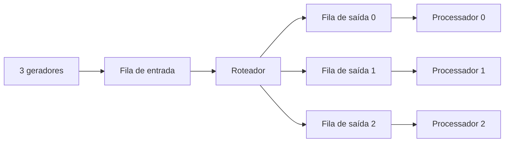

# Multithreaded Packet Router in C

Simulador acadêmico de roteamento de pacotes desenvolvido em C com POSIX
Threads, mutexes, semáforos e buffers circulares limitados. O projeto demonstra
concorrência, sincronização, comunicação entre threads e prevenção de deadlock
em um fluxo produtor-consumidor com múltiplas etapas.

## Visão geral

Três threads geradoras simulam fontes de tráfego e inserem pacotes em uma fila
de entrada compartilhada. Uma thread roteadora consome esses pacotes e os
encaminha para uma das três filas de saída. Cada fila possui uma thread
processadora dedicada. Uma thread adicional acompanha as estatísticas do
sistema durante a execução.



## Conceitos demonstrados

- criação e sincronização de threads com `pthread`;
- padrão produtor-consumidor em duas etapas;
- buffers circulares limitados;
- exclusão mútua com `pthread_mutex_t`;
- controle de vagas e itens disponíveis com `sem_t`;
- estado de encerramento com operações atômicas de C11;
- geração pseudoaleatória independente por thread;
- prevenção de busy-wait e encerramento coordenado;
- tratamento correto dos códigos de erro da API POSIX;
- análise das quatro condições de Coffman para deadlock.

## Sincronização

| Recurso | Proteção | Responsabilidade |
| --- | --- | --- |
| Fila de entrada | `mutex_entrada` e dois semáforos | Coordenar geradores e roteador |
| Filas de saída | Um mutex e dois semáforos por destino | Coordenar roteador e processadores |
| Identificador global | `mutex_id` | Evitar IDs duplicados por *lost update* |
| Estatísticas | `mutex_stats` | Proteger contadores compartilhados |
| Estado do sistema | `atomic_bool` | Comunicar encerramento sem data race |

Os semáforos de vagas são aguardados antes da aquisição dos mutexes. Assim, uma
thread nunca mantém o mutex da fila enquanto espera surgir espaço no buffer.
Essa ordem evita uma espera circular entre roteador e processadores.

## Requisitos

- sistema compatível com POSIX, como Linux;
- GCC ou Clang com suporte a C11;
- GNU Make.

## Compilação e execução

```bash
make
make run
```

Também é possível compilar diretamente:

```bash
gcc -std=c11 -Wall -Wextra -Wpedantic -pthread src/roteador.c -o packet-router
./packet-router
```

Ao final, o programa apresenta a quantidade total de pacotes gerados, roteados
e processados, além da distribuição por destino. A configuração padrão utiliza
30 pacotes, três geradores e três destinos.

## Validação de concorrência

O alvo abaixo compila e executa o programa com ThreadSanitizer:

```bash
make tsan
```

A versão atual foi validada sem data races detectadas. A primeira implementação
utilizava uma variável `volatile` como sinal de encerramento; ela foi substituída
por `atomic_bool`, pois `volatile` não fornece sincronização entre threads.

## Estudo de deadlock

O final de [`src/roteador.c`](src/roteador.c) documenta um experimento controlado
que demonstra como um deadlock poderia surgir caso a roteadora:

1. adquirisse o mutex de uma fila de saída cheia;
2. aguardasse uma vaga mantendo o mutex bloqueado;
3. impedisse a processadora de adquirir o mesmo mutex para liberar uma vaga.

Nesse cenário aparecem exclusão mútua, posse e espera, ausência de preempção e
espera circular. A implementação funcional evita o ciclo aguardando primeiro o
semáforo de vagas e adquirindo o mutex somente depois.

## Estrutura

```text
.
├── Makefile
├── README.md
└── src
    └── roteador.c
```

## Contexto

Projeto desenvolvido por Felipe Gilaverte como atividade de Sistemas
Operacionais, com foco em programação concorrente e fundamentos de sistemas.
É uma simulação educacional: os pacotes são estruturas em memória e não tráfego
real de rede.
